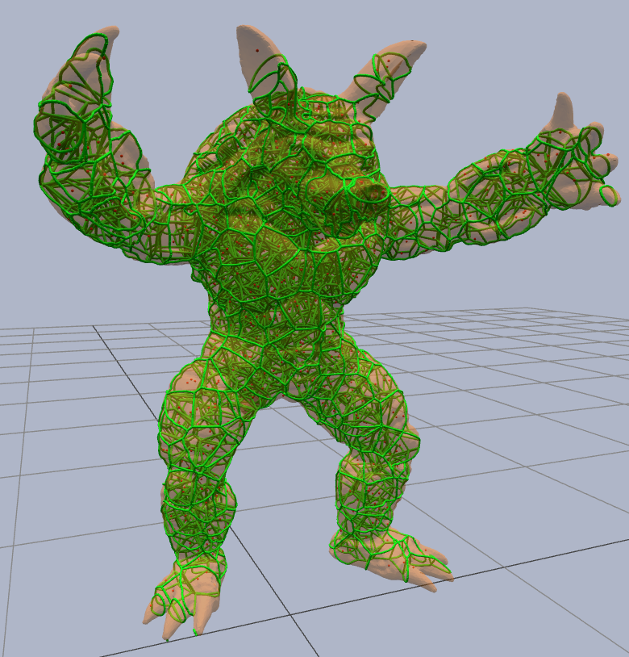

# [StochasticLatticeGen](https://zalo.github.io/StochasticLatticeGen/)

<p align="left">
  <a href="https://github.com/zalo/StochasticLatticeGen/deployments/activity_log?environment=github-pages">
      </a>
  <a href="https://github.com/zalo/StochasticLatticeGen/commits/main">
      </a>
  <a href="https://github.com/zalo/StochasticLatticeGen/blob/main/LICENSE">
      </a>
</p>

Generate mesh-bounded stochastic (Voronoi) lattices in the browser, and export them as watertight strut meshes.

[](https://zalo.github.io/StochasticLatticeGen/)

## Library

`src/index.js` is a dependency-light ES module that works on the main thread, in a worker, or in Node.

```js
import { StochasticLattice, meshToSTL } from 'stochastic-lattice-gen';

// Any closed triangle mesh: a three.js BufferGeometry or { positions: Float32Array, indices: Uint32Array }
const lattice = new StochasticLattice(geometry, { offset: -2 }); // inset the lattice boundary by 2 units

const seeds = lattice.samplePoints({ mode: 'volume', count: 1000, seed: 7 }); // or mode: 'surface'
const graph = await lattice.computeLattice(seeds, { clipping: 'conforming', pruneIslands: true });
//    graph.positions / graph.edges: a welded strut graph (LatticeGraph)

const solid = await lattice.sweep(graph, { radius: 0.5, profile: 'icosphere' }); // { positions, indices }
const stl   = meshToSTL(solid); // ArrayBuffer
```

Pipeline stages, each also exported on its own:

| Stage | Function | Notes |
| --- | --- | --- |
| Prepare | `prepareGeometry`, `offsetGeometry` | Welds vertices, computes smooth normals, builds the inset/outset clipping surface (vertex-normal offset). |
| Seed | `sampleSurfacePoints`, `sampleVolumePoints` | Area-uniform surface sampling or rejection-sampled volume points; seedable. |
| Voronoi | `computeVoronoiCells`, `addVoronoiEdges`, `voronoiFaceGeometry` | Voro++ (via `voro3d`) cells clipped to the bounding box. |
| Clip | `trimGraphToMesh`, `addSurfaceContours` | Cuts struts at the surface; adds the curves where cell walls cut the surface. |
| Sweep | `sweepGraph` | Convex hull of a cube / icosahedron / icosphere at both ends of every strut, batch-unioned with [manifold-3d](https://github.com/elalish/manifold) into one 2-manifold mesh. |
| Export | `pointsToPLY`, `graphToPLY`, `meshToSTL`, `meshToOBJ` | Plain strings / ArrayBuffers; no DOM required. |

Clipping modes: `unconstrained` (bounding box only), `trimmed` (struts cut at the surface), `conforming` (trimmed struts plus surface contours; closed lattices), `surface` (contours only).

The `offset` option insets (negative) or outsets (positive) the clipping surface by displacing vertices along their smooth normals. Each vertex's travel is clamped to half the local mesh thickness, so features thinner than twice the inset collapse to a sliver rather than turning inside out; it is an approximation of a true offset surface, not a replacement for one.

Every stage accepts an `onProgress(stage, fraction)` callback; `fraction` is `-1` while a stage's length is unknown.

## Demo

The demo (`src/demo/`) runs the library in a web worker, previews the lattice as instanced cylinders, and exports seed points (PLY), lattice edges (PLY) and the swept strut mesh (STL / OBJ). *Placement* puts the lattice on the surface, fully outside it (Exterior: offset +thickness/2) or fully inside it (Interior: offset −thickness/2); tick *Custom Offset* to set the distance directly. Drag a mesh file (OBJ, STL, GLB/GLTF, FBX, USDZ) onto the page to lattice it.

```
npm install
npm run dev      # serves the un-bundled source at http://127.0.0.1:8000 (uses the import map in index.html)
npm run build    # bundles main thread + worker into ./build as a static site
npm test         # runs the library end-to-end in Node against assets/armadillo.obj
```

The GitHub Pages deployment publishes `./build`.

## Dependencies

 - [manifold-3d](https://github.com/elalish/manifold) (hulls and robust batch unions for the strut mesh)
 - [Voro3D](https://github.com/LukPopp0/voro3d) (Voro++ Voronoi cell computation)
 - [three.js](https://github.com/mrdoob/three.js/) (geometry utilities, rendering)
 - [three-mesh-bvh](https://github.com/gkjohnson/three-mesh-bvh) (raycasts, inside tests, triangle intersections)
 - [esbuild](https://github.com/evanw/esbuild/) (bundling) and [es-module-shims](https://github.com/guybedford/es-module-shims) (import maps inside the worker when running un-bundled)
